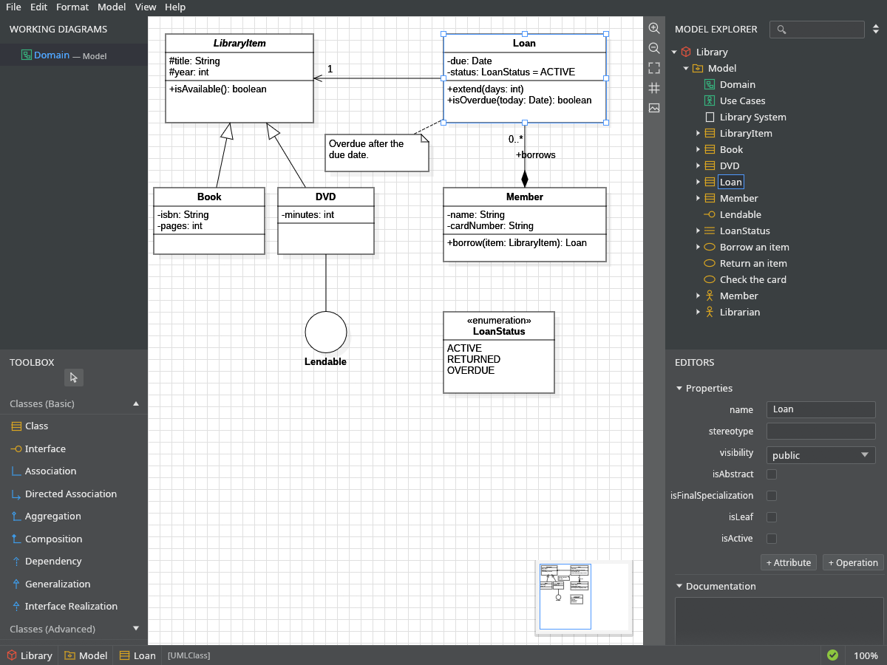
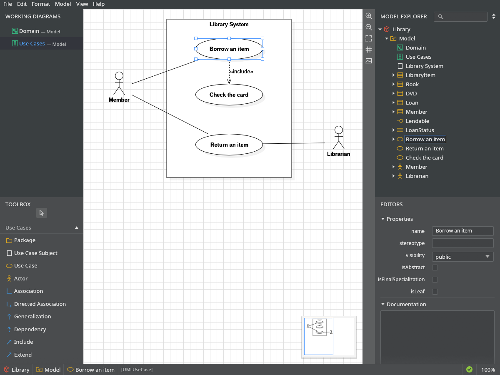

<p align="center">
  
</p>

<h1 align="center">UMLCraft</h1>

<p align="center">
  <b>UML modeling; an open-source, clean-room reimplementation of StarUML, rebuilt in pure Rust.</b><br>
  Class and use case diagrams, a model explorer, a property editor and real <code>.mdj</code> files,<br>
  in a native app written entirely in Rust. Open source, offline, and yours.
</p>

<p align="center">
  
  
  
  
  <br>
  <a href="https://github.com/BurkhalterY/umlcraft/actions/workflows/release.yml"></a>
  <a href="https://github.com/BurkhalterY/umlcraft/releases"></a>
</p>

<p align="center">
  <a href="https://github.com/BurkhalterY/umlcraft/releases"><b>Download UMLCraft</b></a> ·
  <a href="https://getartcraft.com/apps">All Crafting Apps</a> ·
  <a href="https://github.com/storytold/craft-anything">Made with Craft Anything</a>
</p>

<br>

<p align="center">
  
  <br>
  <sub>A library domain model: inheritance, a composition with multiplicities, an interface shown as a ball, an enumeration and a note,<br>with the Loan class selected in the diagram, the Model Explorer and the property editor.</sub>
</p>

<p align="center">
  <a href="#features">Features</a> ·
  <a href="#everything-in-the-box">Everything in the box</a> ·
  <a href="#mdj-without-compromise">.mdj</a> ·
  <a href="#under-the-hood">Under the hood</a> ·
  <a href="#get-started">Get started</a> ·
  <a href="#downloads">Downloads</a> ·
  <a href="#the-crafting-apps">Crafting Apps</a>
</p>

<br>

<table>
  <tr>
    <td width="25%" valign="top">
      <h3>🎛️ Familiar by design</h3>
      Working Diagrams and the Toolbox on the left, the Model Explorer and Editors on the right, the same dark theme and the same shortcuts. If you know StarUML, you already know UMLCraft.
    </td>
    <td width="25%" valign="top">
      <h3>⚡ Native and fast</h3>
      One small binary on egui and OpenGL that starts in a blink. No Electron, no web view, no waiting.
    </td>
    <td width="25%" valign="top">
      <h3>🗂️ Real .mdj files</h3>
      Open and save StarUML projects. Files come back with the same structure and key order, and anything UMLCraft does not edit is written back untouched.
    </td>
    <td width="25%" valign="top">
      <h3>📦 Installs everywhere</h3>
      MSI, DMG, AppImage, deb, rpm and FreeBSD pkg, for x64 and ARM, built on every release by one GitHub workflow.
    </td>
  </tr>
</table>

<br>

## Features

Every screenshot here is the real app, rendered with its <code>--screenshot</code> option from <a href="examples/library.mdj"><code>examples/library.mdj</code></a>.

<table>
  <tr>
    <td width="50%" valign="top">
      
      <br>
      <sub>Classes, an abstract class, an interface, an enumeration and a note, joined by every kind of line.</sub>
      <h3>Class diagrams</h3>
      Classes, interfaces, enumerations, data types, signals, packages, notes and text, with associations, directed associations, aggregations, compositions, dependencies, generalizations and interface realizations.
      <br><br>
      <b>Type right on the diagram:</b> double-click an attribute and write <code>-id: int[1] = 0</code>, or an operation and write <code>+placeOrder(item: Order, qty: int): boolean</code>. Visibility, types, multiplicities, defaults and parameters are read from what you type.
    </td>
    <td width="50%" valign="top">
      
      <br>
      <sub>Actors, a system boundary and use cases, with an «include» relationship.</sub>
      <h3>Use case diagrams</h3>
      Actors, use cases, use case subjects and packages, with associations, generalizations, dependencies, includes and extends. Boundaries stay behind what they contain and carry it along when you move them.
      <br><br>
      Composite structure diagrams (ports, parts, connectors), statechart diagrams (states, pseudostates, transitions), activity diagrams (actions, control and object nodes, regions, flows) and flowcharts (all 27 symbols and flows) are editable too. Every other diagram kind in a StarUML file (sequence, communication, ERD and more) opens, is drawn from its saved shapes, and is saved back exactly as it was.
    </td>
  </tr>
</table>

## Everything in the box

| Area | What you get |
|---|---|
| **Editing** | Rubber-band (by overlap) and Shift selection, Tab to walk the views, moving with snap to grid, dropping boxes into packages and subjects, eight resize handles, auto resize, bend points, rectilinear segments, reconnecting a line by its end, draggable line labels, four line styles, arrow-key nudging, Ctrl+drag to pan; Robustness boundary, entity and control icons; free lines, containment lines, association classes, template bindings, constraints, qualifiers, object diagrams with objects, instances, slots and links, composite structures with ports, parts and connectors, and statecharts with states, pseudostates and transitions |
| **Clipboard** | Cut, copy and paste of views (as new views of the same models) and of model elements (as deep copies), through the system clipboard; copy a diagram as a picture |
| **Typing on the diagram** | `<<stereotype>> +Name`, attributes and operations parsed as you type; Ctrl+Enter adds an attribute (a literal, extension point or slot where that fits), Ctrl+Shift+Enter an operation, Ctrl+Delete removes one, Up/Down walk them; association role names with aggregation, navigability and multiplicity menus; word wrap; buttons that add a sub-class, super-class, interface, associated class, note… with its relationship |
| **Format** | Fonts and sizes, fill, line and text colours (a Color dialog with opacity and a palette), shadow, show/suppress compartments and visibility, stereotype display, align, distribute, size equally, bring to front and send to back, automatic layout in four directions, generated overview, type hierarchy and package structure diagrams, class diagrams from Mermaid code, all from the Format menu, a Styles panel and the original's shortcuts |
| **Model Explorer** | The whole model as a tree in the original's order, quick search, sort by name, stereotype text, expand and collapse all, arrow keys, drag to move elements, right-click to add elements, diagrams, tags, attributes, operations, literals and parameters, drag onto a diagram (relationships come along), Enter to rename in place, a Relationships panel |
| **Editors** | Styles (with text alignment for notes), every property of classes, attributes, operations, parameters, literals, relationships and both association ends, several elements at once, an Element Picker for types and stereotypes, documentation with a Markdown panel and preview, and a Tag Editor (Ctrl+T) |
| **Find and check** | Quick Find (Ctrl+P), Model › Find (Ctrl+F), a Command Palette (Ctrl+Shift+P), Select In Diagram (Ctrl+D), and StarUML's UML and core validation rules with a results panel |
| **Views** | Working Diagrams remembered per file, Next/Previous Diagram, zoom from 10% to 300% around the screen centre, fit to window, a live mini-map, diagram thumbnails, every panel on Ctrl+1 to Ctrl+6 and resizable by dragging its edge, dark and light themes, your own shortcuts in `keymap.json`, Preferences for the grid and the style of new views |
| **History** | Undo and redo for every change, the last 100 kept (Ctrl+Z, Ctrl+Y or Ctrl+Shift+Z) |
| **Export** | PNG, JPEG and SVG of one diagram or of every diagram into a folder, drawn off-screen with the original's 10-pixel margin; Print to PDF, one diagram per page, in any of 50 page sizes; HTML docs of the whole model; XMI 2.1 and model fragments (`.mfj`) in and out; new projects from the UML templates, with the UML Standard Profile |
| **Command line** | `umlcraft model.mdj`, `--diagram <name>`, `--select <name>`, `--screenshot out.png`, `--resave in.mdj out.mdj`, `umlcraft image model.mdj -f png\|jpeg\|svg -s <selector> -o <file>` , `umlcraft pdf model.mdj -z A4 -l landscape -o out.pdf` and `umlcraft html model.mdj -o docs` to export without a window |

## .mdj without compromise

UMLCraft keeps a project as the very JSON objects the file contains, so it understands what it edits and carries everything else along unchanged:

- Saved files use the same tab indentation, key order and left-out defaults as StarUML, and new ids have the same 14-byte form.
- Files saved by StarUML open and save again with an identical structure; files saved by UMLCraft open in StarUML without errors.
- The rules behind this (field order, defaults, sizes, arrow shapes, colours) are written down with their sources in [`MECHANICS.md`](MECHANICS.md) and checked by the tests.

## Under the hood

| Part | Built with |
|---|---|
| Window, widgets and drawing | [egui](https://github.com/emilk/egui) through eframe, rendered with OpenGL (glow) |
| `.mdj` reading and writing | [serde_json](https://github.com/serde-rs/json) with preserved key order |
| File dialogs | [rfd](https://github.com/PolyMeilex/rfd) (GTK on Linux and FreeBSD, native elsewhere) |
| PNG pictures | [image](https://github.com/image-rs/image) |
| Diagram text | the system's Arial, or Liberation Sans, which has the same metrics |

| File | What it does |
|---|---|
| `src/model.rs`, `src/meta.rs` | The project and the `.mdj` element kinds, fields and defaults |
| `src/views.rs`, `src/render.rs`, `src/export.rs` | Laying out and drawing boxes, labels and lines, on screen and into PNG, JPEG and SVG |
| `src/layout.rs`, `src/generate.rs` | Format › Layout (the layered automatic layout) and Tools › Diagram Generator |
| `src/mermaid.rs` | Tools › Generate Diagram by Mermaid: class diagrams from Mermaid code |
| `src/html.rs` | File › Export › HTML Docs: one page per element, an SVG and image map per diagram |
| `src/xmi.rs` | File › Export › XMI Export and File › Import › XMI Import (v2.1): the model elements as OMG XMI 2.1, without diagrams, and a small XML reader |
| `src/markdown.rs` | View › Markdown Documentation: the editor and a small Markdown preview |
| `src/thumbs.rs` | View › Diagram Thumbnails |
| `src/relview.rs` | View › Relationships: the relationships of the selected element |
| `src/input.rs` | The input dialog (Working Diagrams › Rename) |
| `src/api.rs` | The local HTTP API on port 58321 (diagram list, images, Mermaid generation) |
| `src/keymap.rs` | The user's `keymap.json`: keystrokes bound to command ids |
| `src/fragment.rs` | File › Import / Export › Fragment: `.mfj` files |
| `src/templates.rs` | File › New From Template: the UML templates |
| `src/picker.rs` | The Element Picker ("Select Element") and the name lookup of type and stereotype fields |
| `src/picture.rs` | Pictures of Image views: files read into data URLs with their natural size, and decoded for drawing |
| `src/pdf.rs` | Print to PDF: the dialog, its remembered options and a small PDF writer |
| `src/canvas.rs`, `src/parse.rs`, `src/align.rs`, `src/clipboard.rs`, `src/style.rs`, `src/related.rs` | The diagram canvas, the typed attribute and operation lines, Format › Alignment, cut, copy and paste, view colours, and the inline edit's "add related element" buttons |
| `src/splitter.rs` | Panel splitters: drag a panel's edge to resize it, or below 10 px to hide it |
| `src/main.rs`, `src/cli.rs`, `src/selector.rs` | Start-up, the window, and the command line (`umlcraft image`, `pdf`, `html`, `--help`) with the element selector language |
| `src/app.rs`, `src/ui.rs`, `src/icons.rs`, `src/prefs.rs`, `src/tags.rs`, `src/palette.rs`, `src/find.rs`, `src/validate.rs` | Project state, undo, open and save, and the panels, menus and icons |
| `src/tests.rs` | Round-trips of StarUML files, editing, saving and keyboard shortcuts |
| `packaging/`, `.github/workflows/release.yml` | Installers for every system and the workflow that builds them |

## Get started

Download an installer from the [releases page](https://github.com/BurkhalterY/umlcraft/releases), or build it yourself with a recent [Rust](https://rustup.rs) toolchain:

```sh
git clone https://github.com/BurkhalterY/umlcraft
cd umlcraft
cargo run --release -- examples/library.mdj
cargo test --release
```

On Linux, install the GTK 3, xkbcommon and OpenGL development packages first (on Debian and Ubuntu: `libgtk-3-dev libxkbcommon-dev libgl1-mesa-dev`).

> [!IMPORTANT]
> **Status:** UMLCraft is in early alpha. Class, package, object, use case, information flow, profile, component and deployment diagrams are editable; other diagram kinds open, show and save but cannot be edited yet. On macOS, double-clicking a `.mdj` file starts UMLCraft but does not open the file yet; use File › Open. Please file issues with your system and a screenshot.

## Downloads

Every release on the [releases page](https://github.com/BurkhalterY/umlcraft/releases) carries these files and a `SHA256SUMS.txt`.

### Windows

| Build | Installer | Portable |
|---|---|---|
| x64 (64-bit Intel/AMD) | `UMLCraft-<ver>-windows-x64.msi` | `UMLCraft-<ver>-windows-x64-portable.zip` |
| arm64 (Snapdragon and other ARM PCs) | `UMLCraft-<ver>-windows-arm64.msi` | `UMLCraft-<ver>-windows-arm64-portable.zip` |

### macOS

| Build | File | Notes |
|---|---|---|
| App, universal (Apple silicon + Intel) | `UMLCraft-<ver>-macos-universal.dmg` | Also as a `.zip`; signed and notarized when the release has the Apple certificates |

### Linux

| Format | x86_64 | aarch64 (ARM64) | Notes |
|---|---|---|---|
| AppImage | `UMLCraft-<ver>-x86_64.AppImage` | `UMLCraft-<ver>-aarch64.AppImage` | Runs anywhere |
| Debian/Ubuntu | `umlcraft_<ver>_amd64.deb` | `umlcraft_<ver>_arm64.deb` | |
| Fedora/RHEL/openSUSE | `umlcraft-<ver>-1.x86_64.rpm` | `umlcraft-<ver>-1.aarch64.rpm` | |
| Tarball | `umlcraft-<ver>-linux-x86_64.tar.gz` | `umlcraft-<ver>-linux-aarch64.tar.gz` | Unpack anywhere |

### FreeBSD

| Build | File |
|---|---|
| x86_64 | `umlcraft-<ver>.pkg` (`pkg add`) and `umlcraft-<ver>-freebsd-x86_64.tar.gz` |

The [release workflow](.github/workflows/release.yml) builds all of them and publishes a new release every night when `main` has changed, so the download is never more than a day behind. The version comes from the [Conventional Commits](https://www.conventionalcommits.org) since the last release: while UMLCraft is 0.x, a breaking change raises the middle number and anything else the last one. Run the workflow from the Actions tab to release right away, or as a dry run to get the installers as artifacts only. Signing turns on when the repository has the secrets `APPLE_CERTIFICATE`, `APPLE_CERTIFICATE_PASSWORD`, `KEYCHAIN_PASSWORD`, `APPLE_ID`, `APPLE_PASSWORD`, `APPLE_TEAM_ID`, `WINDOWS_CERTIFICATE` and `WINDOWS_CERTIFICATE_PASSWORD`; without them Windows warns about an unknown publisher and macOS asks you to confirm the first start.

## The Crafting Apps

UMLCraft was made with [Craft Anything](https://github.com/storytold/craft-anything), which looks at how a program works and helps rebuild it in Rust. It is a community app in the spirit of the [Crafting Apps](https://getartcraft.com/apps), such as [PhotoCraft](https://github.com/storytold/photocraft), [CADCraft](https://github.com/storytold/cadcraft) and [WordCraft](https://github.com/storytold/wordcraft), and is not made by or affiliated with the ArtCraft team or with StarUML's makers.

## License and credits

UMLCraft is released under the [MIT license](LICENSE).

It is a clean-room reimplementation: StarUML's code was read to learn its rules (the `.mdj` layout, field names and defaults, sizes, arrow shapes, colours and window layout), those rules were written down with their sources in [`MECHANICS.md`](MECHANICS.md), and every file here was written from scratch from that sheet. No StarUML source, icon or logo is included. StarUML is a trademark of its owners and is named here only to describe file compatibility. The icons are simple drawings made for UMLCraft, and diagram text uses the fonts installed on your computer.
